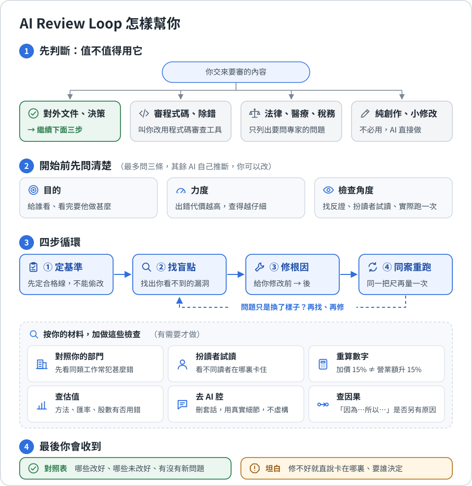

# Agentic Skills Center

三個給 AI agent（例如 Codex、Claude Code）用的 skill。skill 是一個寫好工作方法的資料夾：裝好後，AI 遇到對應的工作，就照這套方法做。每個 skill 都針對直接叫 AI 做時常見的不足，並寫明它在甚麼情況下不應出手。

## 🔎 AI Review Loop：審完、改完，再核對是否真的改好了

直接叫 AI 審查，它會即場指出問題；改完再問一次，很難分清問題是真的解決了，還是換了個樣子留下來。AI Review Loop 先定好判斷標準（由 AI 按你的材料草擬，你可以修改），再找出問題根源、提出最小修改，然後用同一批檢查重跑。它不保證 AI 永遠正確，但令修改前後的比較可以核對、可以重跑。

**和直接叫 AI 審查有甚麼不同：**

- **先定目的，不只挑錯。** 開始前先訂明文件給誰看、看完要做甚麼、怎樣才算成功，除了查有沒有錯，也查能否達到目的，例如模擬目標讀者看一次，找出會卡住、誤解或未被說服的地方（標明是模擬，不當作真實用戶意見）。說服力、可讀性這類主觀判斷，先定好比較標準；同一個 AI 自己說好不算通過，會建議你另開一個對話或請真人核對。
- **摘要、新聞稿這類由其他資料寫成的文件，先讀完原始資料。** 查有沒有誇大，也查有沒有漏掉重點。
- **不照單全收，主動找反證。** 因果會逐步核對：「股價下跌，主因是加息」，如果同期公司下調了盈利指引，而同業同樣受加息影響卻跌得較少，就只能說兩件事同期出現、份量未能分拆。數字會重算：「咖啡加價 15%，營業額增加 15%」，如果咖啡只佔營業額七成，未計客人流失，增幅其實約 10.5%。政策、價格、市場數據這類會過時的資料，連你提供的也照查最新資料，附來源和日期；查不到就標明「未查證」，不用 AI 的記憶補上。
- **改完用同一批檢查重跑。** 產品資料寫明「產品正在開發，尚未推出，沒有營收」，AI 生成的產品介紹卻寫「已正式推出並開始盈利」。你在指示中加上「不可寫已推出、不可提盈利」再生成，新版本不再提這兩點，卻改寫成「即將推出，現已開放登記試用」，而「開放登記試用」同樣是產品資料沒有的事。只再問一次「有沒有問題」，很容易當作已經改好；AI Review Loop 會用一開始定下的「不可加入產品資料沒有的事」再查，指出這項仍未通過，只是問題換了樣子。每項檢查都列明結果；建議還未套用、或未能檢查的，不會當作已改好。

**適合：** 策略、研究、產品、表單、流程及 AI 生成內容。常見用法：

| 部門 | 常見審查對象 |
| --- | --- |
| 市場推廣及公關 | 新聞稿、社交帖文、產品介紹 |
| 產品及客戶服務 | 報名表、服務流程、常見問題、客服回覆 |
| 管理層及業務發展 | 計劃書、提案、加價或擴張決定 |
| 財務及投資研究 | 估值報告、財務分析 |
| 顧問及研究 | 客戶報告、政策分析 |
| AI 及營運自動化 | prompt 及自動化流程改版、AI 生成內容 |

**不適合：** 審查程式碼、測試軟件、除錯（用 Claude Code 等工具本身的審查和測試功能）；法律、醫療、稅務的最終判斷（它只整理問題和要問專家的問題，不下結論）；寫標題這類純創作，或改錯字這類低風險小事（直接完成或給意見就夠）。它只會給你修改建議，你同意後才會改動原本的文件。

**怎樣啟動：** 它不會自動啟動，免得 AI 在其他工作（例如寫程式的項目）自行套用這套方法。要用時，Claude Code 輸入 `/ai-review-loop`，Codex 輸入 `$ai-review-loop`，後面接你的要求。

## 🔁 Agent Execution Retrospective：AI 做錯了，找出下次怎樣避免

AI 剛做完、中途停下或做壞一件工作時，你說一句「檢討這次 AI 執行有甚麼做錯」，它就會根據這次對話中 AI 實際做過的事，找出做法上最值得改的地方。它不靠印象，也不看其他對話。

**你會得到：**

- 最多兩項改善建議，每項都寫明下次怎樣檢查是否真的做到了。
- 你要求找出根本原因時，它會列出幾個可能的原因，逐一比較支持和反對的證據，不會一看到說得通的解釋就認定是它。
- 它只會提建議，不會自己記住教訓。你決定採納後，叫 AI 把建議寫進專案的規則檔（例如 Claude Code 的 `CLAUDE.md`、Codex 的 `AGENTS.md`），下次才會生效。

**不適合：** 查進度、比較方案、決定重做還是繼續、檢查工具是否故障、修改做出來的成品，以及團隊檢討或事故報告。

## 🧭 Content-Led Interactive Web：網站由你的內容出發，不套模板

一般叫 AI 做網站，它會先揀一個常見的版型，再把你的文字放進去。這個 skill 不會這樣做：它先了解讀者來到網站要做甚麼、你的內容想說甚麼，再決定網站的樣子和互動。

**你會得到：**

- 動手前，給你三個真正不同的方向揀：讀者先看甚麼後看甚麼、內容怎樣編排、主要的互動方式，三個方向都不同，不只是換顏色和字體。
- 每次都按該次的內容和品牌重新定風格，不會沿用上一個作品的樣子。
- 交付前用真實瀏覽器，在手機和電腦的闊度都檢查一次，確保文字和按鈕不會被遮住。修正兩次仍未過關，會清楚說明未完成；你用的 AI 工具開不到瀏覽器時，它會標明畫面未經檢查。

**不適合：** 修小 bug、只做網站上的單一元件、照抄現有網站的版面。

## 安裝

按你用的工具，把其中一句交給你的 AI agent：

- Claude Code：

  > 請把 https://github.com/Adamchanadam/agentic-skills-center/tree/main/skills/ai-review-loop 這個 skill 資料夾安裝到 `~/.claude/skills/`。

- Codex：

  > 請把 https://github.com/Adamchanadam/agentic-skills-center/tree/main/skills/ai-review-loop 這個 skill 資料夾安裝到 `~/.agents/skills/`。

要裝另一個 skill，把網址最後的 `ai-review-loop` 換成 `agent-execution-retrospective` 或 `content-led-interactive-web`。裝好後開一個新對話，輸入 `/`（Claude Code）或 `$`（Codex），清單見到該 skill 的名稱，就是裝好了。

## 第一次使用

AI Review Loop 要輸入指令才會啟動，例如：

- Claude Code：`/ai-review-loop 審查這份新聞稿，讀者是現有客戶。`
- Codex：`$ai-review-loop 審查這份新聞稿，讀者是現有客戶。`

另外兩個 skill 用平常說話的方式叫就可以，例如：

- 「檢討這次 AI 執行有甚麼做錯，最多給兩項改善。」
- 「用 Content-Led Interactive Web 設計一個新網站，內容在這個資料夾。」

這兩個也可以直接指名：Claude Code 輸入 `/` 加 skill 名稱，Codex 輸入 `$` 加 skill 名稱。

## 回報問題

請到 [Issues](https://github.com/Adamchanadam/agentic-skills-center/issues) 開一個新 issue，寫明：你原本叫 AI 做甚麼、哪個 skill 錯誤啟動或應該啟動卻沒有、你期望它怎樣做，以及這會不會在同類任務重複發生。
